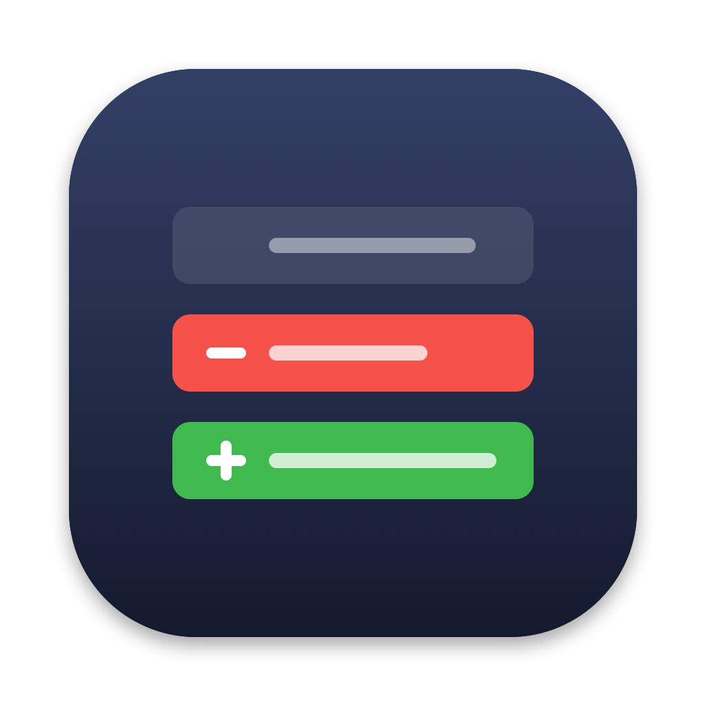

# OptimusDiff



OptimusDiff (`opdiff` on the command line).

A small native macOS app for reviewing the diff between two branches before opening a pull request — like GitHub's "Comparing changes" page, but local. It can also ask [Claude Code](https://docs.claude.com/en/docs/claude-code/overview) to point out the lines that deserve your attention.

Requires macOS 14+ and Xcode / Command Line Tools.

## Features

**Comparing**
- Pick **base** and **compare** branches (searchable; you can also type any ref: tag, SHA, `HEAD~3`)
- Or switch to **Commits** mode to compare two commits on one branch: pick the base commit first, then the compare picker lists only the commits after it
- GitHub semantics: shows what `compare` adds since it diverged from `base` (`base...compare`)
- **Include uncommitted** (on by default): adds staged, unstaged and untracked work when `compare` is the checked-out branch — useful for reviewing what an AI agent just did before committing
- **Refreshes automatically** when files in the repository change or branches move (ignores files in `.gitignore`)
- **Hide whitespace changes** (`git diff -w`)

**Reading the diff**
- All changed files in one scroll with sticky headers, plus a collapsible folder tree
- Unified or split view, "Viewed" checkboxes, commit list, renames/binary/new/deleted files
- Syntax highlighting for ~190 languages (GitHub light/dark themes), done lazily as files scroll into view
- **Word-level highlighting** of what changed inside a modified line
- **More context** / **Full file** buttons on each file
- **Find in diff** (⌘F) across every file
- Keyboard navigation between changes and comments (see below)
- Select lines (click, shift-click) to copy them, copy them as a diff or as a `path:line` reference
- **Open in editor** at the right line: VS Code, Cursor, Zed, Sublime Text, IntelliJ IDEA, Xcode, the default app, or a custom command (Settings, ⌘,)

**Claude review** (optional)
- **Ask Claude** sends the diff to Claude Code, which returns a summary and comments on specific lines (important / attention / info). Comments show inline in the diff and in a side panel; click one to jump to it
- **Preview Prompt…** shows the full prompt and lets you edit it before sending
- **Ask about lines**: select lines and press **A** (or right-click) to ask Claude a question; the answer appears under the lines
- **Resolve** comments as you go, and hide resolved ones
- Reviews and questions are saved per comparison in `~/Library/Application Support/OptimusDiff`, and flagged when the diff has changed since

The review runs your `claude` command (or a shell alias for it, set in the Ask Claude popover) through your login shell with read-only tools: `Read`, `Grep`, `Glob`, and Bash limited to `git diff`, `git show` and `git log`. It needs the [Claude Code CLI](https://docs.claude.com/en/docs/claude-code/overview) installed and logged in; everything else works without it.

## Install

```sh
make install            # builds OptimusDiff.app → ~/Applications, the opdiff command → ~/.local/bin
make install PREFIX=/usr/local/bin   # if ~/.local/bin isn't on your PATH
```

## Usage

From inside any repository:

```sh
opdiff                 # current branch vs. default base (origin/HEAD, else main/master)
opdiff main            # current branch vs. main
opdiff main feature/x  # feature/x vs. main
opdiff -c              # committed changes only
opdiff <sha1> <sha2>   # changes between two commits (opens in Commits mode)
```

`git opdiff …` works too (installed as a `git-opdiff` link; git runs any `git-<name>` on your PATH as `git <name>`).

Claude Code (or any agent) can open it the same way — e.g. ask *"open the diff against main in OptimusDiff"* and it will run `opdiff main`.

You can also launch the app directly and use **File → Open Repository… (⌘O)**, drop a folder on the window, or pick a recent repo.

## Keyboard shortcuts

| Shortcut | Action |
| --- | --- |
| J / K | Next / previous change |
| N / P | Next / previous comment |
| V | Toggle "Viewed" and go to the next file |
| O | Open the current line in your editor |
| A | Ask Claude about the selected lines |
| ⌘F, ⌘G, ⇧⌘G | Find in diff, next / previous match |
| ⇧⌘C, ⌥⇧⌘C | Copy selected lines, as a diff |
| ⌘O | Open repository |
| ⌘R | Refresh |
| ⇧⌘S | Swap base and compare |
| ⌥⌘W | Wrap long lines |
| ⌘, | Settings (editor, diff algorithm, line wrapping, auto-refresh) |

The single-letter shortcuts are also in the **Go** menu, and don't fire while you type in a text field.

## Development

```sh
swift run opdiff         # run from source (uses the current directory if it's a repo)
make build               # debug build
make test                # parser, git integration and review tests
make format              # format the code with swift-format (ships with Xcode / the Swift toolchain)
make lint                # check formatting without changing files
make check               # lint + build + test
make icon                # regenerate Resources/AppIcon.icns from scripts/make-icon.swift
```

Code style is defined in `.swift-format` (4-space indent, 120 columns). Run `make format` before committing.

Code layout:

- `Sources/DiffCore` — no UI, unit tested
  - `Git/` — running git, repository info, comparisons
  - `Diff/` — diff models, parser, word-level diffs, search, navigation, copying
  - `Review/` — review/question prompts, running Claude, parsing its output, placing comments on lines
  - `Support/` — small helpers
- `Sources/OptimusDiff` — SwiftUI app (built as the `opdiff` binary)
  - `App/` — app entry point, main window, welcome screen, command-line options
  - `Model/` — `CompareModel`, the app state; each feature folder adds an extension to it
  - `Diff/` — the diff list, rows, file tree, syntax highlighting, selection/copying, more context
  - `Toolbar/` — branch and commit pickers
  - `Find/`, `Navigation/` (keyboard navigation, open in editor), `Review/`, `Questions/`, `AutoRefresh/`, `Settings/`
  - `Shared/` — small reusable views and helpers
- `scripts/` — `.app` bundling script and the `opdiff` command-line launcher

Syntax highlighting is provided by [HighlighterSwift](https://github.com/smittytone/HighlighterSwift) (MIT), which bundles [highlight.js](https://highlightjs.org) (BSD-3-Clause).

## License

[MIT](LICENSE)
